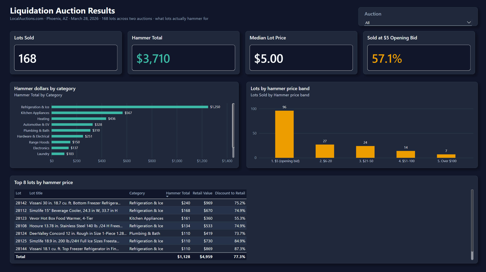
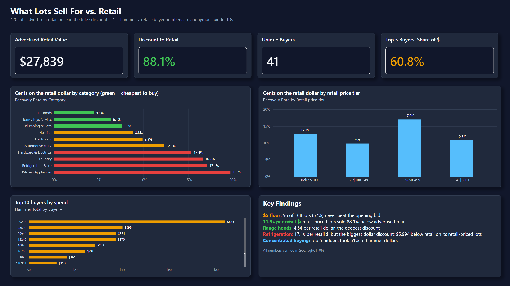

# Auction Inventory Analytics

What do liquidation lots actually sell for, how far below retail, and who is buying? 168 lots from two LocalAuctions.com Phoenix, AZ auctions (Mar 28, 2026), analyzed with **Python**, **SQL Server**, and **Power BI**.

## Findings

- **168 lots, $3,710.02 hammer total.** Median lot: **$5**. 96 of 168 lots (57%) sold at the $5 opening bid.
- **88.1% average discount to retail.** 120 lots advertise a retail price in the title: $27,838.65 retail vs $3,320.02 hammer. That is **11.9 cents per retail dollar**.
- **Buyer concentration is high.** 41 unique buyers. The top buyer took 22.5% of dollars ($835). The top 5 buyers took 61%.
- **Range hoods are the cheapest category**: 4.5 cents per retail dollar.
- **Refrigeration & Ice has the biggest dollar discount**: $5,994.46 (retail minus hammer) across 13 retail-priced lots. This is a retail-to-hammer gap, not a hammer-price spread; its max-min hammer spread is $235.01.
- **Top 8 lots by hammer = 7 appliances + 1 toilet.** The appliances: 5 refrigeration/ice, 1 food warmer, 1 heater. The toilet is lot 28124.

## Dashboard





The Power BI file is `auction-inventory-dashboard.pbix` (reads SQL view `v_lots`). Dark and light themes are in `reports/themes/` (`auction-theme-dark.json`, `auction-theme-light.json`); import via View > Themes > Browse for themes. The 15 measures are documented in [`reports/dax-measures.md`](reports/dax-measures.md).

## Data

Source: LocalAuctions.com public auction results, Phoenix AZ liquidation auctions. Buyer numbers are anonymous bidder IDs; no personal data.

| Auction | Date | Lots | Hammer total |
|---|---|---|---|
| Home & Kitchen Liquidation (ID 23154) | Mar 28, 2026 | 162 | $3,535.02 |
| Pallets Liquidation (ID 23166) | Mar 28, 2026 | 6 | $175.00 |
| **Combined** | | **168** | **$3,710.02** |

`data/raw/` holds the original exports, untouched, plus `auction_23613_items_list.csv` (an item-listing template). See `data/README.md` for the cleaned-file columns.

## Project structure

```
auction-inventory-analytics/
|-- auction-inventory-dashboard.pbix
|-- requirements.txt
|-- analysis/
|   `-- auction_analysis.py          # parse exports, clean, print findings, write data/*_clean.csv
|-- data/
|   |-- README.md
|   |-- home_kitchen_results_clean.csv
|   |-- pallets_results_clean.csv
|   `-- raw/                         # original xlsx/csv exports
|-- sql/
|   |-- 00_setup_database.sql        # DB, BULK INSERT load, v_lots view
|   |-- 01_auction_summary.sql
|   |-- 02_price_distribution.sql
|   |-- 03_discount_to_retail.sql
|   |-- 04_top_lots.sql
|   |-- 05_buyer_concentration.sql
|   |-- 06_category_margin.sql
|   `-- results/                     # screenshots of each query's output
`-- reports/
    |-- dax-measures.md
    |-- screenshots/                 # dashboard pages
    `-- themes/                      # auction-theme-dark.json, auction-theme-light.json
```

## Reproduce

1. **Python** (cleans the exports, prints the findings):
   ```bash
   pip install -r requirements.txt
   python analysis/auction_analysis.py
   ```
   Writes `data/home_kitchen_results_clean.csv` and `data/pallets_results_clean.csv`.
2. **SQL Server** (instance `.\SQLEXPRESS`): copy the two cleaned CSVs to `C:\Users\Public\auction-inventory\` (the path `00_setup_database.sql` uses in `BULK INSERT`; the SQL Server service account must be able to read it, and you can edit the paths). Run `sql/00_setup_database.sql`, then `01` to `06`. Check with `sqlcmd -S .\SQLEXPRESS -C -d Auction_Inventory -Q "SELECT COUNT(*) FROM v_lots"` (expect 168).
3. **Power BI**: open the `.pbix`; it connects to `.\SQLEXPRESS`, database `Auction_Inventory`, view `dbo.v_lots`. Refresh.

## Limitations

Known:
- Only 2 auctions on one day, 168 lots. Small sample; do not generalize to other sale dates or locations.
- Retail prices are **parsed from lot titles** (`Retail $...`, case-insensitive). 120 of 168 lots have one; the rest are excluded from discount math. Seller-advertised retail is not verified.
- Categories are rule-based from title keywords; the exports carry no category.
- The export has a single `Price` column per lot; no fee or premium column.

Assumed:
- `Price` is treated as the hammer price. Whether LocalAuctions.com adds a buyer's premium or taxes on top is not in the data, so the real cost to buyers may be higher than shown.
- $5 is the opening bid (it is the minimum price in the data).

## Next

- Track the same auctions over time for seasonal pricing.
- A bid-ceiling calculator: retail price and category in, max bid for a target resale margin out.
