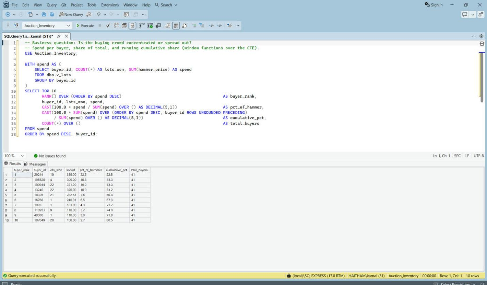
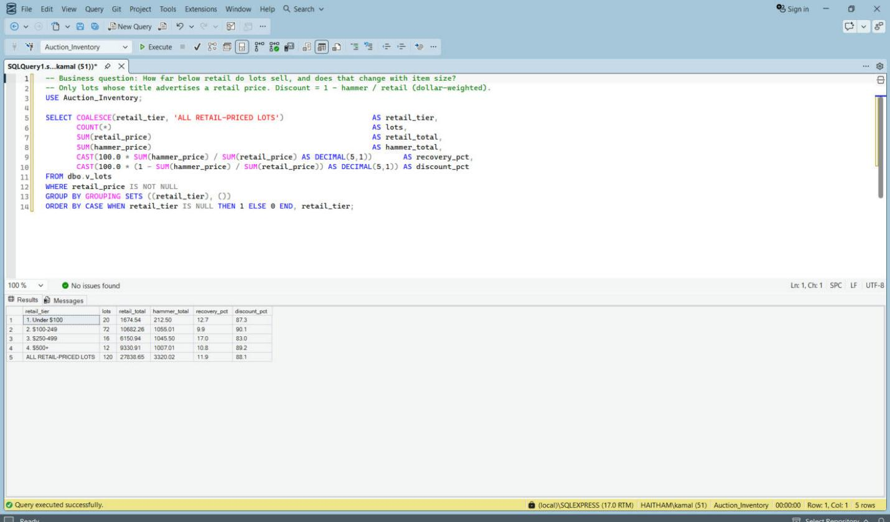

# Auction Inventory Analytics

Python, T-SQL (SQL Server) and Power BI analysis of 168 liquidation lots from two LocalAuctions.com Phoenix, AZ auctions (Mar 28, 2026).

  

## 1. Executive Summary & Business Context

**Question:** what do liquidation lots sell for, how far below advertised retail, and who is buying?

Resellers and liquidation buyers live on the gap between hammer price and resale value, and on knowing whether a few
bidders dominate the room. This project measures both from public auction results.

**Scope:** two Phoenix liquidation auctions on one day (Home & Kitchen, Pallets). Small sample, historical results, not
real-time. Do not generalize to other dates or locations. The data has no cost, fee or resale columns, so this project
does **not** measure realized margin; it compares hammer price to seller-advertised retail only.

## 2. Data Architecture & Schema

Pipeline: LocalAuctions.com xlsx exports (`data/raw/`) -> `analysis/auction_analysis.py` (clean, parse retail from
titles, categorize) -> `data/*_clean.csv` -> SQL Server `Auction_Inventory` (`BULK INSERT`) -> view `v_lots` -> Power BI.

| Object | Role |
|---|---|
| `dbo.auctions` | One row per auction: `auction_id` (PK), name, date, city |
| `dbo.lots` | One row per lot: `auction_id` (FK), `lot`, `title`, `buyer_id`, `quantity`, `hammer_price` |
| `dbo.v_lots` | Analysis view: adds `retail_price` (parsed from title), `category` (title keywords), `price_band`, `retail_tier`, `discount_to_retail` |

Relationship: `auctions` 1-to-many `lots` on `auction_id`; Power BI reads the flattened `v_lots` view.

| Auction | Date | Lots | Hammer total |
|---|---|---|---|
| Home & Kitchen Liquidation (ID 23154) | Mar 28, 2026 | 162 | $3,535.02 |
| Pallets Liquidation (ID 23166) | Mar 28, 2026 | 6 | $175.00 |
| **Combined** | | **168** | **$3,710.02** |

Buyer numbers are anonymous bidder IDs; no personal data. Cleaned-file columns: [`data/README.md`](data/README.md).

## 3. Key Technical Implementations

### T-SQL ([`sql/`](sql/))

| Metric | Query | Technique |
|---|---|---|
| Load check: 168 lots, $3,710.02, 120 retail-priced | [`00_setup_database.sql`](sql/00_setup_database.sql) | `BULK INSERT`, reconciliation counts, `CASE` view logic |
| Lots, hammer, median $5, 41 buyers, 57% at $5 | [`01_auction_summary.sql`](sql/01_auction_summary.sql) | `PERCENTILE_CONT` window for the median |
| Lots and dollars per price band | [`02_price_distribution.sql`](sql/02_price_distribution.sql) | `GROUP BY`, `OVER ()` share of total |
| 88.1% discount to retail, by retail tier | [`03_discount_to_retail.sql`](sql/03_discount_to_retail.sql) | conditional aggregation |
| Top 10 lots by hammer | [`04_top_lots.sql`](sql/04_top_lots.sql) | CTE + `RANK()` |
| Buyer concentration: 22.5% top buyer, 61% top 5 | [`05_buyer_concentration.sql`](sql/05_buyer_concentration.sql) | CTE + `RANK()`, cumulative share |
| Category retail-to-hammer spread | [`06_category_margin.sql`](sql/06_category_margin.sql) | `GROUP BY` drill by category |

`06_category_margin.sql` computes the retail-to-hammer spread (what a reseller has to work with), not realized margin.
Result screenshots: [`sql/results/`](sql/results/).

### Python ([`analysis/auction_analysis.py`](analysis/auction_analysis.py))

- **ETL:** reads both raw xlsx exports with `openpyxl`, cleans them, parses `Retail $...` from lot titles with a
  case-insensitive regex, assigns keyword categories, and writes `data/home_kitchen_results_clean.csv` and
  `data/pallets_results_clean.csv`.
- **Summary statistics:** `statistics.median` and `collections.Counter` produce the headline numbers printed to the console.
- Dependencies are listed in [`requirements.txt`](requirements.txt).

### Power BI / DAX ([`reports/dax-measures.md`](reports/dax-measures.md))

15 documented measures over `FactLots`, two report pages (auction overview; buyers and retail), dark and light themes in
`reports/themes/`.

## 4. Visuals / Deliverables


<a href="sql/results/05_buyer_concentration.png"></a>
<a href="sql/results/03_discount_to_retail.png"></a>

**Adding or refreshing exports:** save dashboard page captures into `reports/screenshots/` (or `docs/images/`, for
example `docs/images/dashboard_overview.png`), SSMS result captures into `sql/results/`, and reference them with
``.

Deliverable: [`auction-inventory-dashboard.pbix`](auction-inventory-dashboard.pbix).

## 5. Insights & Actionable Takeaways

1. **Lots sell far below advertised retail.** 120 lots advertise a retail price: $27,838.65 retail vs $3,320.02 hammer, or
   **88.1% below retail** (11.9 cents per retail dollar). *Action:* set bid ceilings as a small fraction of retail.
2. **The opening bid is the market price for most lots.** 168 lots made $3,710.02; the median lot is $5 and 96 lots
   (57%) sold at the $5 opening bid. *Action:* competition is thin on most lots, so bid early at the floor.
3. **Buyers are concentrated.** 41 unique buyers; the top buyer took 22.5% of dollars ($835) and the top 5 took 61%.
   *Action:* a handful of bidders set the pricing, so know who they are before choosing which lots to chase.
4. **Category spread differs sharply.** Range hoods sell at 4.5 cents per retail dollar; Refrigeration & Ice has the
   biggest dollar gap, $5,994.46 across 13 retail-priced lots. Seven of the top 8 lots by hammer were appliances.
   *Action:* prioritize refrigeration for dollar upside and hoods for percentage discount.

## 6. Setup & Reproduction Guide

**Requirements:** Python 3, SQL Server Express + SSMS, Power BI Desktop (Windows).

1. **Clone:** `git clone https://github.com/Haitham1111/auction-inventory-analytics.git`
2. **Python step:**
   ```bash
   pip install -r requirements.txt
   python analysis/auction_analysis.py
   ```
   Parses the raw exports, prints the findings, and rewrites the two cleaned CSVs in `data/`.
3. **Stage the CSVs:** copy the two cleaned CSVs from `data/` to `C:\Users\Public\auction-inventory\` (the path used by
   `BULK INSERT`; edit `00_setup_database.sql` if you use another, and make sure the SQL Server service account can read it).
4. **Build the database:** in SSMS run `sql/00_setup_database.sql`, then `01` to `06`.
5. **Verify:** `sqlcmd -S .\SQLEXPRESS -C -d Auction_Inventory -Q "SELECT COUNT(*) FROM v_lots"` (expect 168).
6. **Dashboard:** open the `.pbix` in Power BI Desktop (it reads `.\SQLEXPRESS`, database `Auction_Inventory`, view
   `dbo.v_lots`) and click *Refresh*. Optional themes: *View > Themes > Browse for themes*, then pick a file from `reports/themes/`.

## Limitations

- Two auctions on one day, 168 lots. Small sample, not real-time.
- Retail prices are parsed from lot titles (`Retail $...`). 120 of 168 lots have one; the rest are excluded from discount
  math. Seller-advertised retail is not verified.
- No cost data, so no realized margin. Only hammer vs advertised retail.
- Categories are rule-based from title keywords; the exports carry no category.
- `Price` is treated as the hammer price. Buyer's premium or taxes are not in the data, so real cost to buyers may be higher.
- $5 is assumed to be the opening bid (it is the minimum price in the data).

## Author

**Haitham Saleh** - LinkedIn: https://www.linkedin.com/in/haitham-saleh-8a1a12206 | GitHub: https://github.com/Haitham1111
