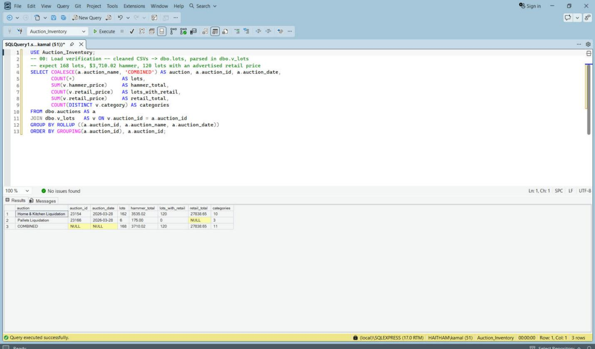
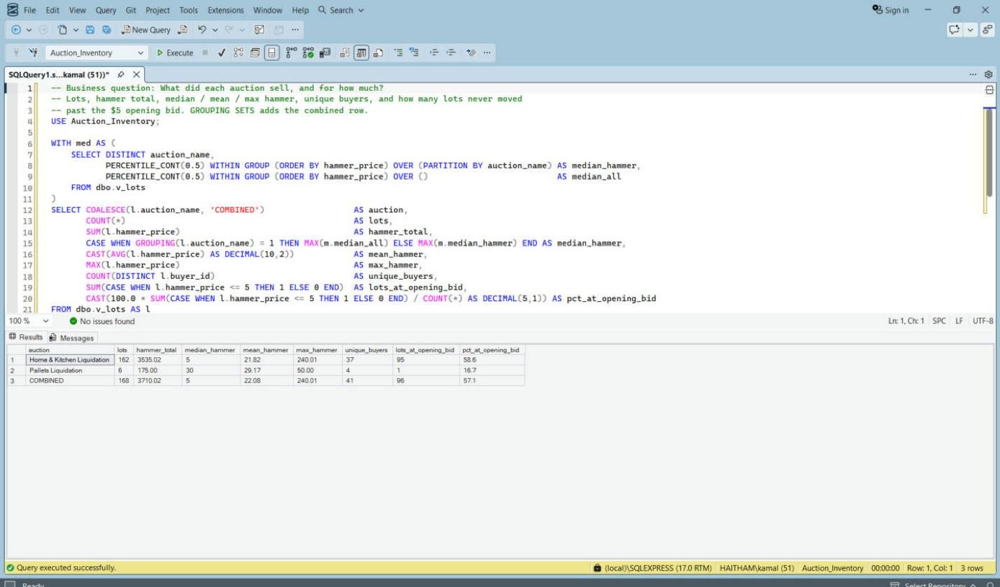
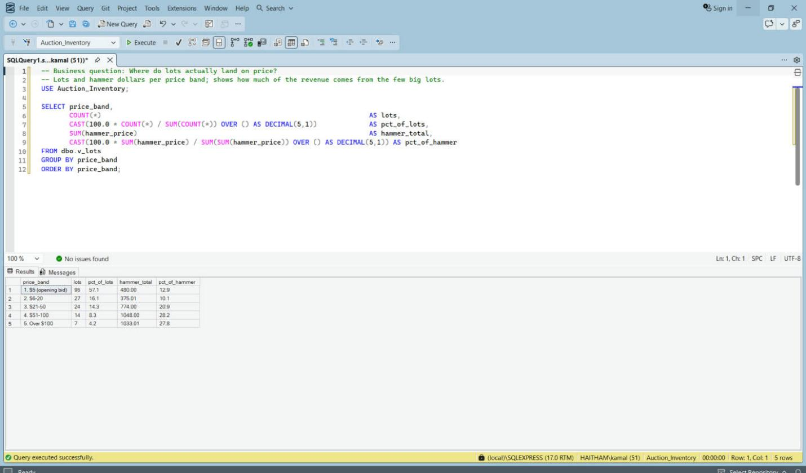
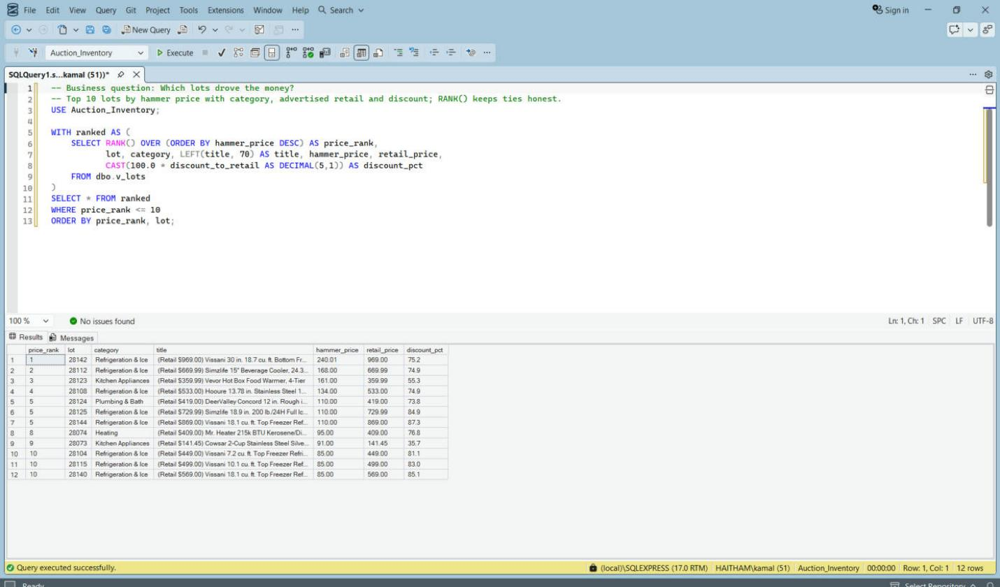
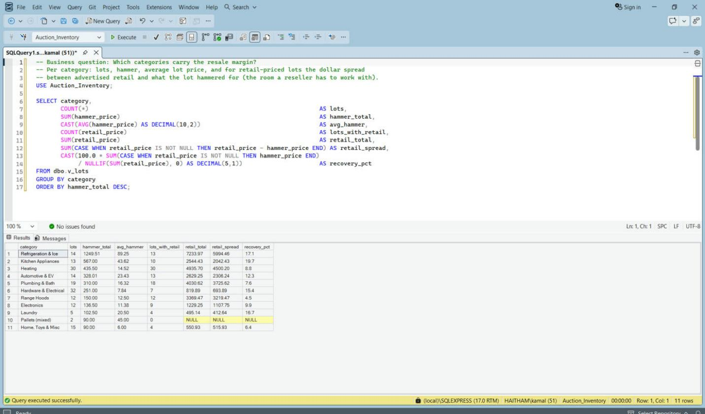
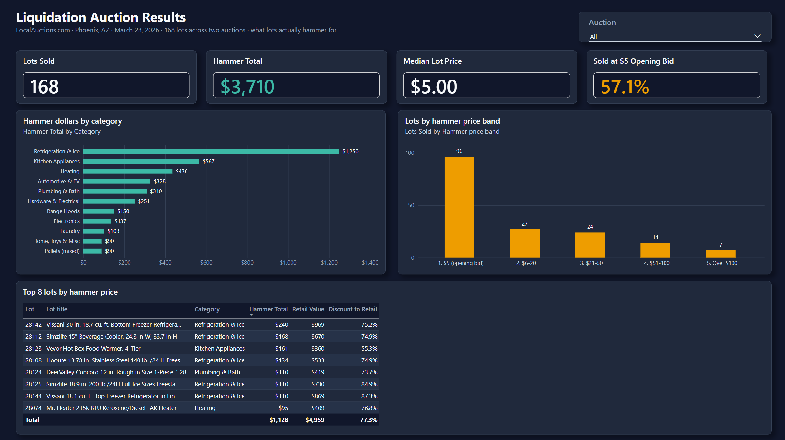
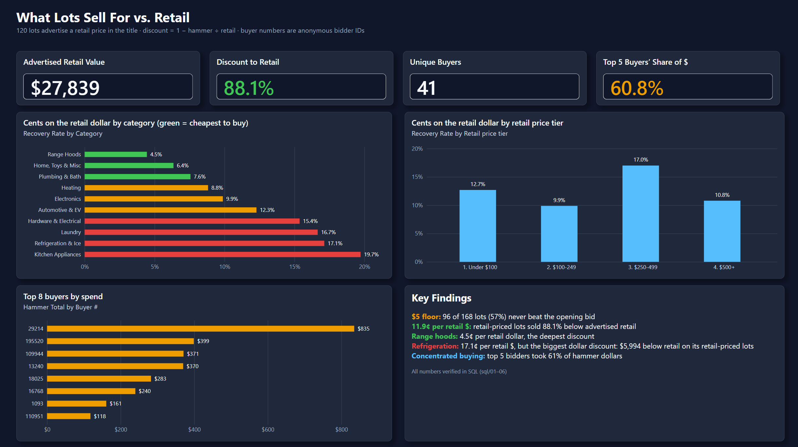

# Auction Inventory Analytics

Python, SQL Server and Power BI analysis of 168 liquidation lots from two LocalAuctions.com Phoenix, AZ auctions (Mar 28, 2026).

## 1. Business Problem & Executive Summary

**Question:** what do liquidation lots sell for, how far below advertised retail, and who is buying?

**Scope:** two Phoenix liquidation auctions on one day (Home & Kitchen, Pallets). Small sample, historical results, not real-time. Do not generalize to other dates or locations.

- **168 lots, $3,710.02 hammer total.** Median lot: $5. 96 lots (57%) sold at the $5 opening bid.
- **88.1% below advertised retail.** 120 lots advertise a retail price in the title: $27,838.65 retail vs $3,320.02 hammer. That is 11.9 cents per retail dollar.
- **Concentrated buyers.** 41 unique buyers. The top buyer took 22.5% of dollars ($835); the top 5 took 61%.
- **Range hoods are the cheapest category:** 4.5 cents per retail dollar.
- **Refrigeration & Ice has the biggest dollar discount:** $5,994.46 (retail minus hammer) across 13 retail-priced lots. This is a retail-to-hammer gap, not a hammer-price spread.
- **Top 8 lots by hammer:** 7 appliances (5 refrigeration/ice, 1 food warmer, 1 heater) and 1 toilet (lot 28124).

The data has no cost, fee or resale columns, so this project does **not** measure realized margin. It compares hammer price to seller-advertised retail only.

## 2. Data Architecture & Relational Schema

Pipeline: LocalAuctions.com xlsx exports (`data/raw/`) -> `analysis/auction_analysis.py` (clean, parse retail from titles, categorize) -> `data/*_clean.csv` -> SQL Server `Auction_Inventory` (`BULK INSERT`) -> view `v_lots` -> Power BI.

| Object | Role |
|---|---|
| `dbo.auctions` | One row per auction: `auction_id` (PK), name, date, city |
| `dbo.lots` | One row per lot: `auction_id` (FK), `lot`, `title`, `buyer_id`, `quantity`, `hammer_price` |
| `dbo.v_lots` | Analysis view: adds `retail_price` (parsed from title), `category` (title keywords), `price_band`, `retail_tier`, `discount_to_retail` |

| Auction | Date | Lots | Hammer total |
|---|---|---|---|
| Home & Kitchen Liquidation (ID 23154) | Mar 28, 2026 | 162 | $3,535.02 |
| Pallets Liquidation (ID 23166) | Mar 28, 2026 | 6 | $175.00 |
| **Combined** | | **168** | **$3,710.02** |

Buyer numbers are anonymous bidder IDs; no personal data. See [`data/README.md`](data/README.md) for cleaned-file columns.

## 3. Key Business Metrics & SQL Proofs

Each query's execution output is saved as a screenshot (SSMS). Click a link to open the file.

| Metric | Query | Result | Preview |
|---|---|---|---|
| Load check: 168 lots, $3,710.02, 120 retail-priced | [00_setup_database.sql](sql/00_setup_database.sql) | [00_load_verification.png](sql/results/00_load_verification.png) | <a href="sql/results/00_load_verification.png"></a> |
| Lots, hammer, median $5, 41 buyers, 57% at $5 | [01_auction_summary.sql](sql/01_auction_summary.sql) | [01_auction_summary.png](sql/results/01_auction_summary.png) | <a href="sql/results/01_auction_summary.png"></a> |
| Lots and dollars per price band | [02_price_distribution.sql](sql/02_price_distribution.sql) | [02_price_distribution.png](sql/results/02_price_distribution.png) | <a href="sql/results/02_price_distribution.png"></a> |
| 88.1% discount to retail, by retail tier | [03_discount_to_retail.sql](sql/03_discount_to_retail.sql) | [03_discount_to_retail.png](sql/results/03_discount_to_retail.png) | <a href="sql/results/03_discount_to_retail.png"></a> |
| Top 10 lots by hammer (RANK) | [04_top_lots.sql](sql/04_top_lots.sql) | [04_top_lots.png](sql/results/04_top_lots.png) | <a href="sql/results/04_top_lots.png"></a> |
| Buyer concentration: 22.5% top buyer, 61% top 5 | [05_buyer_concentration.sql](sql/05_buyer_concentration.sql) | [05_buyer_concentration.png](sql/results/05_buyer_concentration.png) | <a href="sql/results/05_buyer_concentration.png"></a> |
| Category retail-to-hammer spread (hoods 4.5c, refrigeration $5,994.46) | [06_category_margin.sql](sql/06_category_margin.sql) | [06_category_margin.png](sql/results/06_category_margin.png) | <a href="sql/results/06_category_margin.png"></a> |

Note: `06_category_margin.sql` computes the retail-to-hammer spread (what a reseller has to work with), not realized margin. There is no cost data.

## 4. High-Resolution Dashboard Screenshots





Dark and light themes: `reports/themes/`. The 15 DAX measures are in [`reports/dax-measures.md`](reports/dax-measures.md).

## 5. How to Download and Run

**Power BI dashboard**
1. Download [`powerbi/auction-inventory-dashboard.pbix`](powerbi/auction-inventory-dashboard.pbix) (use the Download/Raw button on GitHub).
2. Open in Power BI Desktop. It reads `.\SQLEXPRESS`, database `Auction_Inventory`, view `dbo.v_lots`. Set up the database (below), then Refresh.
3. Optional themes: View > Themes > Browse for themes, pick a file from `reports/themes/`.

**SQL Server Express / SSMS**
1. Copy the two cleaned CSVs from `data/` to `C:\Users\Public\auction-inventory\` (path used by `BULK INSERT` in `00_setup_database.sql`; edit if needed; the SQL Server service account must be able to read it).
2. In SSMS, run `sql/00_setup_database.sql`, then `01` to `06`.
3. Check: `sqlcmd -S .\SQLEXPRESS -C -d Auction_Inventory -Q "SELECT COUNT(*) FROM v_lots"` (expect 168).

**Python**
```bash
pip install -r requirements.txt
python analysis/auction_analysis.py
```
Parses the raw exports, prints the findings, and writes `data/home_kitchen_results_clean.csv` and `data/pallets_results_clean.csv`.

## Limitations

- Two auctions on one day, 168 lots. Small sample, not real-time.
- Retail prices are parsed from lot titles (`Retail $...`). 120 of 168 lots have one; the rest are excluded from discount math. Seller-advertised retail is not verified.
- No cost data, so no realized margin. Only hammer vs advertised retail.
- Categories are rule-based from title keywords; the exports carry no category.
- `Price` is treated as the hammer price. Buyer's premium or taxes are not in the data, so real cost to buyers may be higher.
- $5 is assumed to be the opening bid (it is the minimum price in the data).
- Dashboard screenshots show scrollbars in the category, top-buyer and top-lots visuals.
